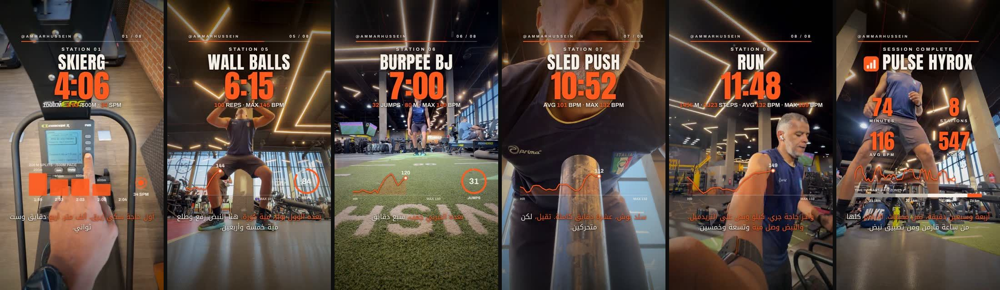
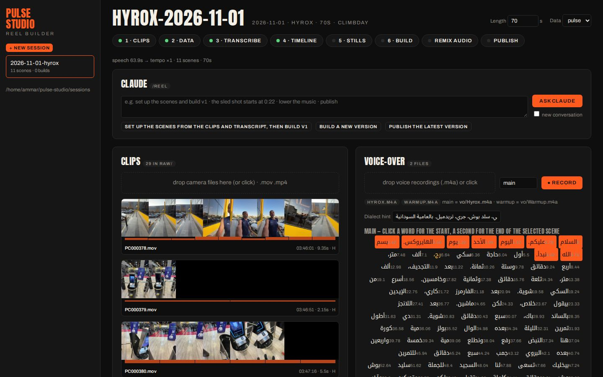
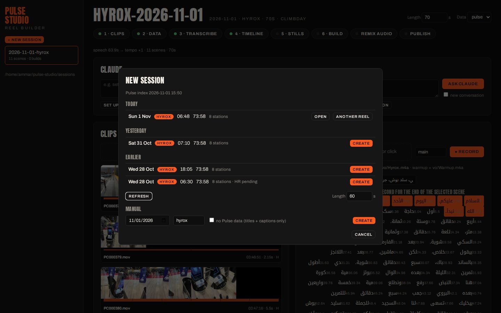
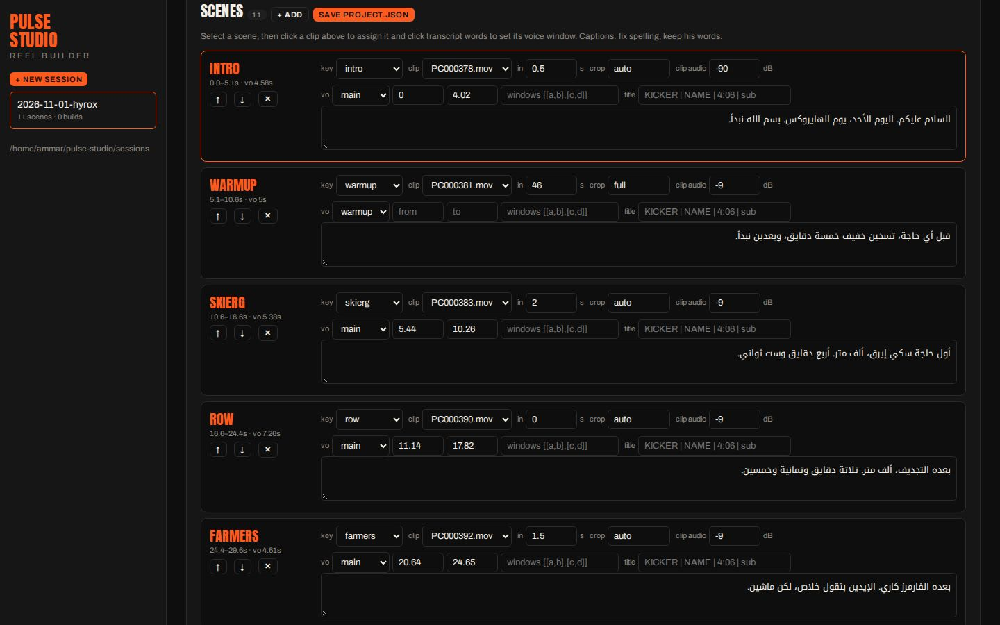

# Pulse Studio

Turns a training session into a 9:16 reel (60 s by default; `vo.budget_s` in project.json or `pulse-reel new --budget 90` for longer): your clips + your voice-over + the session's real numbers (Garmin HR second by second, ErgData splits, steps) rendered as transparent overlays in the climbday identity. Runs entirely on an Ubuntu laptop; no GPU needed.









## Install (Ubuntu 22.04 / 24.04)

```bash
git clone https://github.com/ammarhussein5481-hash/pulse-studio.git
cd pulse-studio
./setup.sh                      # ffmpeg + VAAPI driver, python venv, fonts, chrome-headless-shell (~400 MB total)
echo 'export PULSE_URL=https://<your pulse dashboard> PULSE_TOKEN=<its link token>' >> ~/.bashrc
```

## Two ways to use it

**Web app** — `pulse-reel ui` opens http://127.0.0.1:8787 : pick a Pulse session, drop the camera files and voice recording (or record the voice-over in the browser), and either let the **Claude panel** do the editing or do it yourself (pick a clip and the transcript words for each scene, fix captions), then run stills/build with a live log, play the result and publish. Everything it does is the same CLI steps underneath, so you can mix both.

**Claude Code** — the web app's Claude panel runs headless `claude -p "/reel …"` on the open session (it needs the `claude` CLI logged in); or open `claude` in this folder and type `/reel` to drive the same project.json and commands conversationally ("the sled shot starts from here", "raise the music").

## A new session in the web app, step by step

1. **New session** (left sidebar) → the picker lists your Pulse sessions as *Today / Yesterday / Earlier* (type, start, duration, stations). Set the reel **Length** (60 s, or 70–90 for a Reel) and click **Create**. A session that already has a project shows **Open**.
   No Pulse session (watch not worn)? Use **Manual**: a date, the type, and tick **no Pulse data** — the reel then shows station titles and your captions, no numbers.
2. **Clips** box → drop the camera/phone files. **Voice-over** box → drop the recording(s): one file with all the phrases, plus optional extras such as `Warmup.m4a` (or press **● Record**).
3. **Claude** box → **Set up the scenes from the clips and transcript, then build v1**. Claude runs Clips (contact sheets — the slow part for 4K), Data, Transcribe, writes one scene per station (clip, start point, the voice-over words, corrected caption), checks Timeline and Stills, and builds. Its log streams at the bottom; if it needs a decision (length, which shot) it stops and asks — answer in the same box.
   Prefer to edit yourself? Run **1 · Clips → 2 · Data → 3 · Transcribe**, then in **Scenes**: **+ add**, click a clip, click the first and last transcript word, fix the caption; then **4 · Timeline → 5 · Stills → 6 · Build**.
4. **v1** appears under the builds — play it. Ask for changes in the Claude box ("the sled shot starts at 0:22", "use IMG_8628 for burpees", "music lower"); every change is a new version, older ones are kept.
5. **publish** (Claude box or the Publish step) → share link.

While Claude is working, leave the step buttons and the scene editor alone (the page won't save over its edits), and keep one Pulse Studio tab open.

`pulse-reel --help` lists the commands.

## A session, end to end

```bash
pulse-reel sessions                              # Pulse sessions: today / yesterday / earlier, with their ids
pulse-reel new sessions/2026-11-08-hyrox --from-pulse <id>   # add --budget 90 for a longer reel
#  (or: --date 2026-11-08 --type hyrox, and --no-data for a reel without Pulse numbers)
#  → put the camera files in sessions/2026-11-08-hyrox/raw/, the voice recording in vo/
pulse-reel ingest sessions/2026-11-08-hyrox     # clips by shoot time + contact sheets
pulse-reel data   sessions/2026-11-08-hyrox     # pulls that session's data.json from Pulse
pulse-reel stt    sessions/2026-11-08-hyrox     # word-timed transcript of the voice-over
#  → edit project.json: one scene per station (clip, in-point, VO word window, corrected caption)
pulse-reel timeline sessions/2026-11-08-hyrox   # timing + tempo check
pulse-reel stills   sessions/2026-11-08-hyrox   # overlay QA stills
pulse-reel build    sessions/2026-11-08-hyrox   # ~12 min → out/<name>-v1.mp4 + contact sheet
pulse-reel audio    sessions/2026-11-08-hyrox   # remix only (after changing music/sfx levels)
pulse-reel publish  sessions/2026-11-08-hyrox --to user@host:/var/www/share/   # or set PULSE_SHARE
```

On the VPS, `server/export_session.py` (copied to `/work/pulse-studio-server/` inside the Garmin container) exports every new HYROX session and the index the picker reads. Run it from cron every 10 minutes:

```bash
*/10 * * * * docker exec <garmin container> python /work/pulse-studio-server/export_session.py --sync
```

By hand: `export_session.py 2026-11-08` (a date) or `export_session.py <activity id>`; `--index` only rewrites the index. A session exported before its Garmin heart rate arrived is re-exported automatically for 3 days.

## What a scene looks like (project.json)

```json
{"key": "skierg", "clip": "PC000383.mov", "in": 2.0, "crop": "auto", "amb_db": -9,
 "vo": {"file": "main", "from": 5.44, "to": 10.26},
 "caption": "أول حاجة سكي إيرق، ألف متر. أربع دقايق وست ثواني."}
```

`crop`: `auto` (centre 9:16 from a landscape source), `full` (vertical source as is), or `w:h:x:y` for a punch-in. `vo.windows: [[a,b],[c,d]]` skips filler words. `title` overrides the on-screen kicker/name/number/sub-line. `audio.music_db`, `sfx_db`, `amb_db` set the mix.

## Speed on an i5-7300U (4 threads, no GPU)
Whisper large-v3-turbo on a 90 s voice-over (first run downloads the 1.6 GB model) ≈ 3 min · base cut (4K, VAAPI) ≈ 2 min · 1800 overlay frames ≈ 5 min · final encode ≈ 3 min.

## Who this is for
It is built around one person's setup (a self-hosted "Pulse" dashboard for Garmin/WHOOP data, a HYROX watch app, Sudanese-Arabic voice-overs, the *climbday* visual identity). The engine is generic — any session with clips + a voice-over + a `data.json` in the shape of `examples/hyrox-2026-11-01/data.json` renders — but expect to change `IDENTITY` in `config.py` (fonts, colours, watermark) and the station titles in `overlay/overlay.html` for your own use.

## Credits
Music and SFX are code-generated (numpy), no licensing. Fonts via @fontsource (OFL). Built with Claude Code on 2026-11-01.

## License
Code: MIT (see `LICENSE`). The climbday identity (name, colours/typography combination, the `@AMMARHUSSEIN` watermark) and the example session footage/data are Ammar Hussein's and are not covered by the MIT grant — replace them in your own builds.
